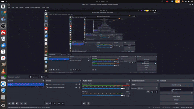
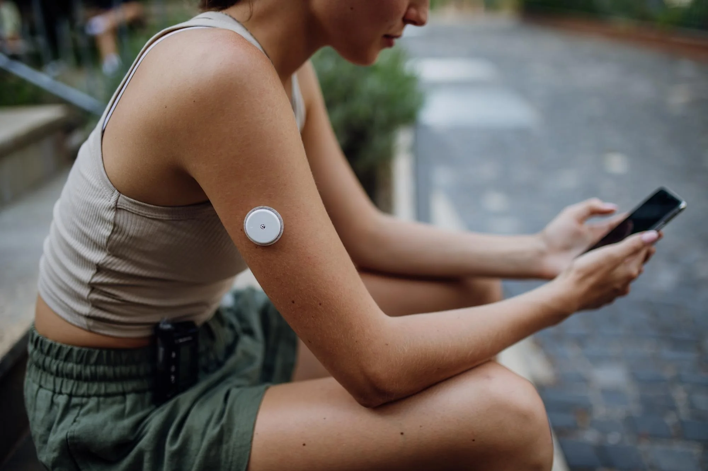
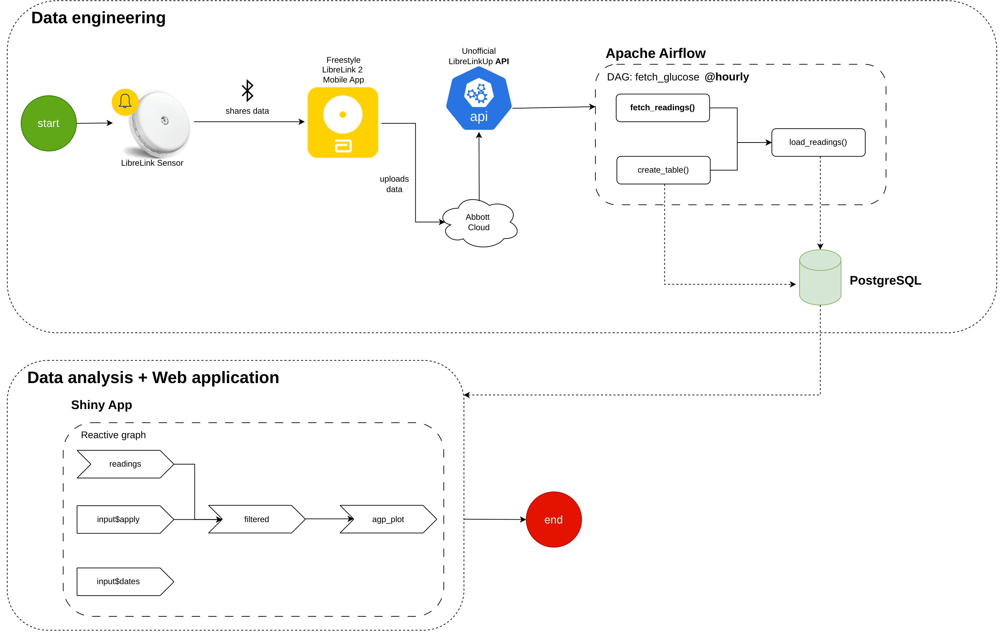
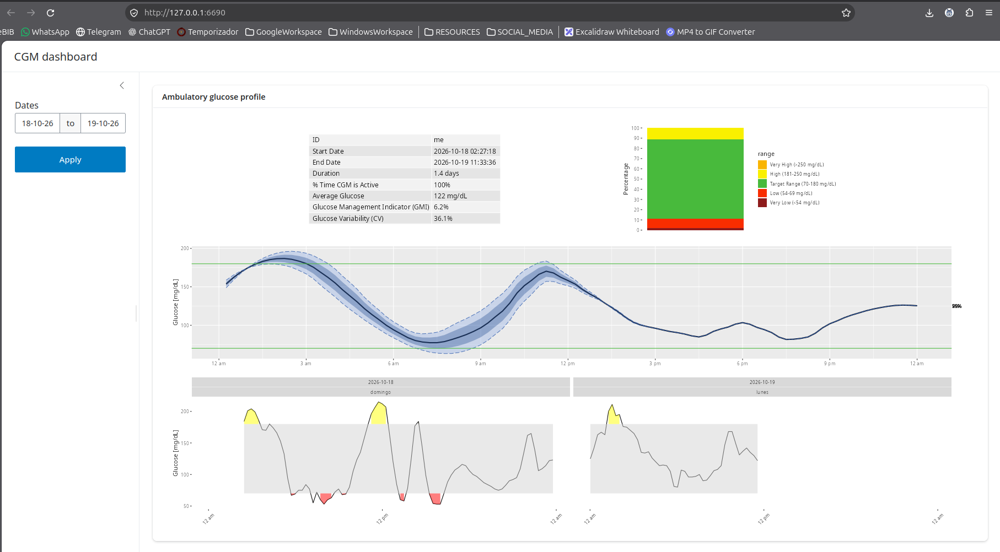

# CGM Analytics: from sensor readings to a daily glucose dashboard


[](https://github.com/MiguelDonado/cgm-analytics/actions/workflows/ci.yml)
[](https://github.com/MiguelDonado/cgm-analytics/actions/workflows/api-check.yml)

A personal project to learn Airflow while building something useful at the same
time.

I have had type 1 diabetes since I was 12. For most of my life I checked my
glucose with finger pricks. Around five years ago, Spain's public health system
started covering CGM (continuous glucose monitoring) sensors. The sensor is
worn on the arm.

All the data generated by the sensor made it a good fit for an Airflow project. 
The useful part is the dashboard built on top of it: I check it for a few minutes every 
night or a few days per week to see how I can improve my glucose levels.

**Live dashboard:** <https://01a1877e-e313-43cc-1175-1692af9db78a.share.connect.posit.cloud/>
(the first visit after a while takes a few seconds, while the app and the
database wake up)

---

## 🎥 Video Tutorials

> [!IMPORTANT]
> **Watch these videos before using the application.**
> - **Developer walkthrough**: how the code works.
> - **User guide**: how to set up and use the application.

---

## Table of Contents

- [CGM Analytics: from sensor readings to a daily glucose dashboard](#cgm-analytics-from-sensor-readings-to-a-daily-glucose-dashboard)
  - [🎥 Video Tutorials](#-video-tutorials)
  - [Table of Contents](#table-of-contents)
  - [Demo](#demo)
  - [Background](#background)
  - [Objectives](#objectives)
  - [Tech stack](#tech-stack)
  - [Workflow](#workflow)
  - [Data analysis](#data-analysis)
  - [Deployment](#deployment)
    - [CI/CD](#cicd)
  - [Getting Started](#getting-started)
    - [Prerequisites](#prerequisites)
    - [Setup](#setup)
    - [First run](#first-run)
    - [After changing the code](#after-changing-the-code)
  - [References](#references)
  - [License](#license)

---

## Demo

A short walkthrough:



---

## Background

I have type 1 diabetes and I use a **FreeStyle Libre 2** sensor for continuous
glucose monitoring (CGM). The sensor is a small device worn on the back of the
arm that measures glucose every few minutes. It sends the readings by Bluetooth
to the **FreeStyle LibreLink** app on my phone. Each sensor lasts 14 days and is
then replaced with a new one.

<p align="center">
  
</p>

The LibreLink app uploads the readings to Abbott's cloud. Abbott offers
[several apps](https://www.freestyle.abbott/es-es/productos/conectividad.html)
that connect to it, but no public API for getting the readings yourself.

The workaround is **LibreLinkUp**, an app that lets family members or
caregivers follow your glucose readings remotely. It gets the data from
Abbott's cloud through a private API. That API has been reverse-engineered, and
the [`pylibrelinkup`](https://github.com/robberwick/pylibrelinkup) library uses
it to log in as a LibreLinkUp follower and download the readings, which is how
this project gets them.

---

## Objectives

1. **Practice Airflow**: build a real data pipeline that runs every hour,
   instead of following toy examples.
2. **Improve my glucose management**: have a dashboard I can check in a couple
   of minutes each day. If I want to use it regularly, it has to be 
   something simple, that can be interpreted quickly and easily shows which 
   aspects should be improved.
3. **Practice with databases**: design a PostgreSQL database to store the
   readings, load data into it from the pipeline and query it from R for the
   dashboard.

---

## Tech stack

- **Python**: extracting and transforming the readings
- **Airflow**: scheduling the pipeline every hour
- **PostgreSQL**: storing the readings
- **R** and **Shiny**: analysis and the web dashboard
- **Docker** and **Docker Hub**: running everything locally, and publishing
  the dashboard image
- **Neon**: managed PostgreSQL in the cloud
- **Posit Connect Cloud**: hosting the shiny web app
- **GitHub Actions**: CI/CD

---

## Workflow

The project has three parts:

1. **Data engineering**: an Airflow DAG runs every hour, extracts the latest
   readings from LibreLinkUp using the `pylibrelinkup` library, transforms them
   and loads them into a PostgreSQL database.
2. **Data analysis**: the readings are analyzed in R with the `iglu` package
   (summary metrics and the AGP).
3. **Web application**: a Shiny app turns the analysis into an interactive,
   data-driven dashboard.

<p align="center">
  
</p>

---

## Data analysis

There are many ways to analyze CGM data. This project uses the most common
summary metrics:

- **Time in ranges**: percentage of readings in each glucose range. The main
  one is **time in range (TIR)**, between 70 and 180 mg/dL; the others show
  how much time is spent low (below 70 and below 54) and high (above 180 and
  above 250).
- **Average glucose**.
- **Glucose variability (CV)**: coefficient of variation, how much glucose
  swings around its average.
- **GMI** (Glucose Management Indicator): an estimate of HbA1c computed from
  the average glucose.

Summary metrics are useful, but they compress weeks of data into a single
number and lose a lot of information. That's why this project also uses the
**AGP** (Ambulatory Glucose Profile).

The AGP stacks all the selected days onto a single 24-hour day and shows, for
each time of day:

- the **median** (50th percentile),
- the **25th–75th percentiles** (the darker band, where half the readings fall),
- the **5th–95th percentiles** (the outer band).

This shows the profile of a typical day: when glucose tends to run high or low,
and how consistent each time of day is. Below the AGP, the dashboard also shows
the glucose of each individual day (up to the last 14 days of the selected
range), to spot specific days that went wrong.

These metrics and the AGP are enough for a quick, useful review of my glucose.
I left out other metrics on purpose, because most of them are redundant and add
little new information. This is how they look in the dashboard:

<p align="center">
  
</p>

---

## Deployment

The dashboard is online, so it can be opened from any browser, even when my
laptop is off. Only Airflow stays on the laptop. The database and the dashboard
run in the cloud:

```
Laptop (Airflow, hourly)  ──writes──▶  Neon (PostgreSQL)  ◀──reads──  Posit Connect Cloud (Shiny)  ◀──  browser
```

- **[Neon](https://neon.tech)** hosts the PostgreSQL database. It's managed
  Postgres 17, the same version as the local container, so Airflow and the
  dashboard only needed new connection settings. It has a free plan and scales
  to zero: it pauses when nothing is connected.
- **[Posit Connect Cloud](https://connect.posit.cloud)** hosts the Shiny app. It
  builds the app straight from this GitHub repo, using `dashboard/manifest.json`
  to install the exact R and package versions. The database credentials are set
  as secrets in Connect Cloud, never in the repo.

Details in [`docs/deployment.md`](docs/deployment.md).

### CI/CD

Every step from a code change to the running dashboard is automated:

| Stage | What happens | How |
|---|---|---|
| **Continuous Integration** | Every push and PR runs the unit tests, the SQL tests against a throwaway Postgres, and the DAG checks | GitHub Actions, [`ci.yml`](.github/workflows/ci.yml) |
| **Continuous Delivery** | Pushing a version tag (`v0.2.0`) builds the dashboard image and publishes it to [Docker Hub](https://hub.docker.com/r/migueldonado/cgm-dashboard) | GitHub Actions, [`publish.yml`](.github/workflows/publish.yml) |
| **Continuous Deployment** | Merging into `main` republishes the live dashboard, with no manual step | Posit Connect Cloud, watching the repo |

A separate daily workflow, [`api-check.yml`](.github/workflows/api-check.yml),
logs in to the real LibreLinkUp API, so I find out within a day if Abbott
changes it.

Details in [`docs/ci-cd.md`](docs/ci-cd.md).

---

## Getting Started

### Prerequisites

- **[Docker](https://docs.docker.com/get-docker/)**: every part of the project
  runs in containers.
- **[Astro CLI](https://www.astronomer.io/docs/astro/cli/install-cli)**: runs
  Airflow locally. No Astronomer account is needed.
- **A LibreLinkUp follower account.** In the FreeStyle LibreLink app, go to
  **Connected Apps → LibreLinkUp** and invite an email address. Create a
  LibreLinkUp account with that email and accept the invitation. The project
  logs in with this account to read the readings.

### Setup

1. **Clone the repository:**

   ```bash
   git clone https://github.com/MiguelDonado/cgm-analytics.git
   cd cgm-analytics
   ```

2. **Create the env files.** They hold the credentials and are kept out of
   git. Copy the templates:

   ```bash
   cp .env.example .env
   cp cgm-db.env.example cgm-db.env
   cp dashboard/.env.example dashboard/.env
   ```

   Then fill them in:

   | File | Used by | What to set |
   |---|---|---|
   | `cgm-db.env` | The glucose database | `POSTGRES_PASSWORD`: choose a password |
   | `.env` | Airflow | The same password in `AIRFLOW_CONN_CGM_DB`, and your LibreLinkUp email and password in `AIRFLOW_CONN_LIBRELINKUP` |
   | `dashboard/.env` | The dashboard | The same password in `CGM_DB_PASSWORD` |

   `astro dev start` fails if `cgm-db.env` or `dashboard/.env` is missing,
   because `docker-compose.override.yml` reads them with `env_file`.

3. **Start everything:**

   ```bash
   astro dev start
   ```

   The first start pulls the dashboard image from
   [Docker Hub](https://hub.docker.com/r/migueldonado/cgm-dashboard).

### First run

1. **Load the first readings.** Open the Airflow UI at
   <http://localhost:8080>, switch on the `fetch_glucose` DAG and click
   **Trigger**. From then on it runs every hour on its own.

   LibreLinkUp only returns about the **last 12 hours** of readings, so the
   history starts the day you set this up. Readings older than that can't be
   recovered, so keep the project running.

2. **Open the dashboard** at <http://localhost:3838>. It picks up new
   readings on its own, within 5 minutes of each DAG run.

### After changing the code

| What changed | Command |
|---|---|
| The pipeline (`dags/`, `src/`, `include/`, `requirements.txt`) | `astro dev restart` |
| The dashboard (`dashboard/`) | `docker build -t migueldonado/cgm-dashboard:0.1.0 dashboard && astro dev restart` |

A local build of the dashboard replaces the published image of the same tag on
this machine, so `astro dev restart` runs your changes.

`astro dev stop` stops all the containers, and the readings are kept. Avoid
`astro dev kill`, because it most likely deletes the database volume along with
all the readings.

---

## References

- [iglu](https://github.com/irinagain/iglu): R package for analyzing CGM data,
  used for the summary metrics and the AGP. Released under the GPL-2 license.
  > Broll S, Urbanek J, Buchanan D, Chun E, Muschelli J, Punjabi N and
  > Gaynanova I (2021). Interpreting blood glucose data with R package iglu.
  > *PLoS One*, 16(4), e0248560.
  > [doi:10.1371/journal.pone.0248560](https://doi.org/10.1371/journal.pone.0248560)
- [pylibrelinkup](https://github.com/robberwick/pylibrelinkup): Python client
  for the LibreLinkUp API.

---

## License

This project is licensed under the [MIT License](LICENSE).